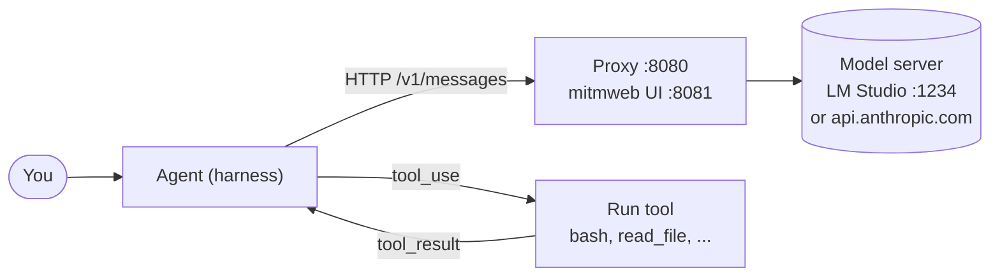
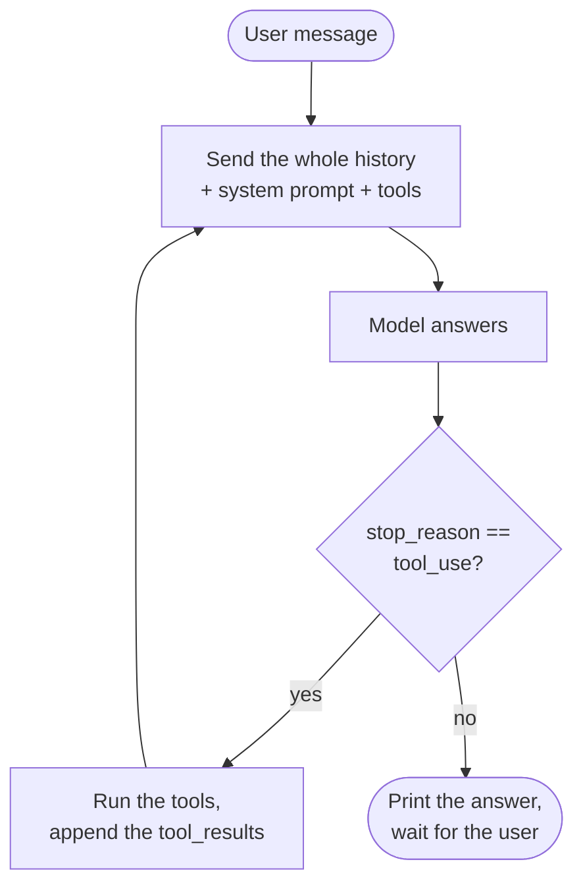

# AI Meetup: Demystify the Agent Harness

Hands-on workshop. In about an hour you will:

1. **See what goes over the wire.** Put a proxy between an agent and the model server and read every request and response: system prompt, tool definitions, the full history, token usage.
2. **Build your own agent.** Start from a chat loop of about 200 lines and add tool calls, file system access, permissions and context management yourself, against a local model or a remote API.

> An agent is a model plus a harness. The model decides; the harness runs the loop, executes the tools and decides what goes into the context. Once you've seen the traffic, there's no magic left.

## The whole idea in two pictures

**Where the traffic goes.** The proxy sits on the wire, so you can read every call:



**What the harness does on every turn:**



## What's in this repo

| Folder | What | Own environment |
|---|---|---|
| [`proxy/`](proxy/) | mitmproxy in reverse mode, plus `sse_clean.py`, which makes streamed responses readable. Also scrubbed sample captures of Claude Code. | `proxy/pyproject.toml` (mitmproxy) |
| [`agent/`](agent/) | **J5**, a minimal coding agent in three steps: chat only → bash tool → file tools | `agent/pyproject.toml` (anthropic, python-dotenv) |
| [`docs/`](docs/) | Model setup: [local](docs/local-model.md), [remote](docs/remote-model.md), [Claude Code through the proxy](docs/claude-code.md) | |
| [`exercises/`](exercises/) | Step-by-step exercises 00–06 | uses the agent's environment |
| `.devcontainer/` | Optional sandbox, so the agent's bash tool can't touch your laptop | |

J5 follows the first lessons of [shareAI-lab/learn-claude-code](https://github.com/shareAI-lab/learn-claude-code) (MIT). That repo has 17 lessons, each with a write-up and code; the exercises here say which lesson to read for more. The exercises were written against commit [`ce8f9f1`](https://github.com/shareAI-lab/learn-claude-code/tree/ce8f9f186058939da54c9d6fead78dfb5d0fd6c3).

## Prerequisites

- macOS, Linux or WSL, with a terminal
- [uv](https://docs.astral.sh/uv/getting-started/installation/) (it installs the right Python for you)
- **One** model:
  - **Local:** [LM Studio](https://lmstudio.ai) with `qwen/qwen3.5-9b` (about 6.5 GB download, 16 GB RAM recommended). See [docs/local-model.md](docs/local-model.md). **Download the model before the workshop**, because venue Wi-Fi won't cope.
  - **Remote:** an Anthropic API key or a key for a compatible provider. See [docs/remote-model.md](docs/remote-model.md).
- Optional: [Claude Code](https://docs.claude.com/en/docs/claude-code), to inspect a production harness

## Quickstart (about 10 minutes)

```bash
git clone https://github.com/JonnyDaenen/ai-meetup-harness-workshop.git
cd ai-meetup-harness-workshop
cp .env.example .env          # defaults to LM Studio through the proxy; edit for remote
```

**Terminal 1: the model.** Start LM Studio's server and load the model (see [docs/local-model.md](docs/local-model.md)):

```bash
lms server start
lms load qwen/qwen3.5-9b
```

**Terminal 2: the proxy.**

```bash
cd proxy
uv run mitmweb --mode reverse:http://127.0.0.1:1234 -p 8080 \
  --set store_streamed_bodies=true --set stream_large_bodies=0 --set http2=false \
  -s sse_clean.py
```

The proxy UI opens at <http://127.0.0.1:8081>. For a remote model, use `--mode reverse:https://api.anthropic.com` instead.

**Terminal 3: the agent.**

```bash
uv run --project agent python agent/j5_00_vanilla.py
```

Say hi. Every request now shows up in mitmweb. Next, go to [exercises/](exercises/).

## Troubleshooting

| Symptom | Fix |
|---|---|
| `KeyError: 'MODEL_ID'` | You have no `.env` in the repo root: `cp .env.example .env` |
| J5 ignores your `.env` (e.g. it calls api.anthropic.com instead of the proxy) | Variables already exported in your shell win over `.env`. Check `env \| grep ANTHROPIC` and `unset ANTHROPIC_BASE_URL ANTHROPIC_API_KEY` |
| `Connection refused` on :8080 | The proxy isn't running (terminal 2) |
| Proxy shows `502 Bad Gateway` | The model server isn't running, or the `--mode reverse:` URL is wrong |
| `authentication_error` from Anthropic | `ANTHROPIC_API_KEY` is missing or wrong in `.env` |
| The local model is very slow or the laptop starts swapping | Use a smaller model, e.g. `mistralai/ministral-3-3b`, or switch to the remote path |
| The model never calls tools | Small local models are unreliable at tool use. Try `google/gemma-4-26b-a4b` or a remote model |
